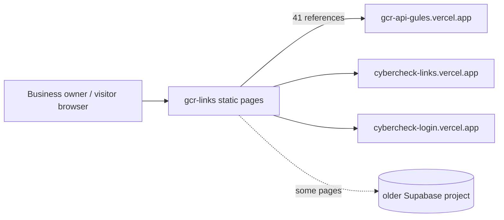

# gcr-links

Static front-end pages for the CyberCheck / Gulf Coast Radar business tools (dashboard, QR menus, menu editors, booking pages, reviews, link-tree), plus sales material.

## What it is

A one-commit snapshot (May 2026) of an older generation of the GCR web front end. It is pages and scripts only, with no build step and no server. Roughly 50 top-level HTML pages cover a business dashboard, restaurant QR-menu and menu-editor pages, booking pages (photographer, charter, boat rental), reviews, a rides page, a directory and a per-business link page. `PLAN /` and `sales /` hold screenshots, pitch decks and planning notes.

## How it works

- `vercel.json` rewrites clean URLs to pages, e.g. `/:slug/links` to `links-page.html`, `/:slug/menu` to `qr-menu.html`, `/:slug/book` to `photographer-booking.html`, `/:slug/charter`, `/:slug/rent`, `/update/:token` to `menu-editor-clean.html`, `/rides`, `/search`, `/directory`, `/reviews/:site_id`.
- `js/` (55 files): per-feature scripts such as `auth.js`, `bookings.js`, `menu.js`, `reviews.js`, `billing.js`, `inventory.js`, `page-builder*.js`, `site-editor.js`, `oauth.js`, `csv-import-*.js`.
- `components/`: embeddable widgets (booking, happy-hour, events, specials, menu with or without images, and others). `css/`, `img/`, `templates.json`, `wp-plugin/cybercheck-consent/`.
- Data calls go to the deployed API `https://gcr-api-gules.vercel.app` (about 40 files reference it; the last commit repointed all calls there). Other hosts referenced: `cybercheck-links.vercel.app`, `cybercheck-login.vercel.app`, `gcr-rosy.vercel.app`, `launching-gcr.vercel.app`.
- Some pages (dashboard, password reset) also use an older Supabase project directly, not the live database.
- Ten top-level pages are empty (0 bytes): `qr-menu.html`, `onboarding.html`, `signup.html`, `reviews.html`, `automations.html`, `charter-booking.html`, `taxi-dashboard.html`, `rides-for-business.html`, `menu-updates.html`, `mobile_menu_with_photos.html`. Routes that point at them (`/:slug/menu`, `/:slug/menu-photo`, `/rides/join`, `/:slug/charter`) render blank.

## Run it

```bash
npx serve .      # any static server; deploys on Vercel with no build
```

No env vars, no `package.json`. Pages need the external APIs above to be reachable. Not run as part of this review.

## Status

Stalled: a large snapshot of an older front end pointing at a superseded API, with several empty pages and many loose screenshots and decks.

## Where it fits



## Related repos

- `launching-gcr-json-load`: newer GCR public front end with the same page family.
- `trip-swipe-`: same API family; shares cobalt seed data ideas with `sales /Plans /`.
- `Dashboards-users-` and `Admin-dashboard-main`: the dashboards this one predates.
- `cybercheck-api-database`, `gcr-api-clean`: the API generations behind these pages (this repo targets the older one).
